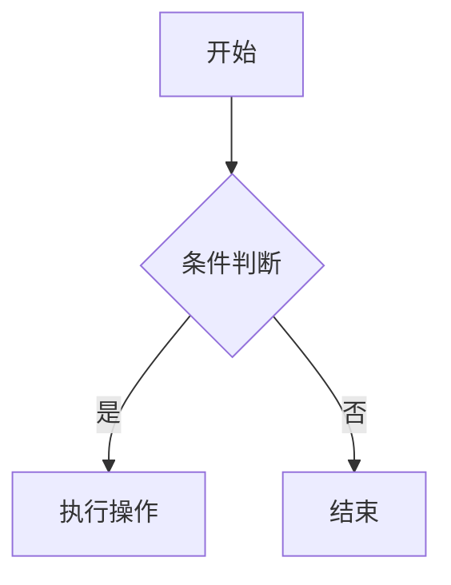

# 🧪 Markdown 渲染与插件支持测试报告

请观察以下区块，凡是**成功渲染**的，说明你的查看器支持该语法；凡是**显示为原始代码/纯文本**的，说明不支持。

---

## 1. 基础核心语法 (CommonMark)

**加粗**、*斜体*、***加粗斜体***、`行内代码`。
[常规链接](https://example.com)
<https://自动链接.com>

### 列表嵌套
- 无序列表项
  1. 嵌套有序列表项
     - 更深层嵌套

---

## 2. GFM 扩展语法 (GitHub Flavored Markdown)

### 删除线
~~这段文字应该有一根删除线穿过~~

### 任务列表 (复选框)
- [x] 这是一个已选中的复选框
- [ ] 这是一个未选中的复选框

### 表格与对齐
| 默认对齐 | 左对齐 | 居中对齐 | 右对齐 |
| --- | :--- | :---: | ---: |
| 内容 | 内容 | 内容 | 内容 |
| 较长内容测试 | 123 | ✅ | 456 |

---

## 3. 数学公式支持 (KaTeX / MathJax)

### 行内公式
当 \(a \ne 0\) 时，方程 \(ax^2 + bx + c = 0\) 有两个解。
*(注：如果你看到的是上面这行文字，说明支持行内公式；如果是 `\(a \ne 0\)` 这种源码，说明不支持。)*

### 块级公式
$$
\zeta(s) = \sum_{n=1}^{\infty}\frac{1}{n^s} = \prod_{p\ \text{prime}}\left(1-\frac{1}{p^s}\right)^{-1}
$$
*(注：如果你看到的是居中的漂亮公式，说明支持。)*

---

## 4. 进阶扩展插件测试

### 4.1 脚注 (Footnotes)
这里有一个脚注引用[^1]，看看底部有没有生成脚注区域。

[^1]: 如果你能看到我，说明查看器支持脚注插件！

### 4.2 高亮文本 (Highlight / Mark)
这是 ==高亮标记== 的文本。
*(注：如果你看到的只是普通的“高亮标记”四个字，没有黄色背景，说明不支持。)*

### 4.3 下标与上标 (Subscript / Superscript)
水分子是 H~2~O，爱因斯坦质能方程是 E = mc^2^。
*(注：如果 2 没有变小下沉/上浮，说明不支持。)*

### 4.4 定义列表 (Definition Lists)
苹果
: 一种很好吃的水果，通常长在树上。
*(注：如果“一种很好吃...”前面没有缩进，说明不支持。)*

---

## 5. 代码块与图表渲染

### 5.1 代码高亮 (Syntax Highlighting)
```python
def hello_markdown():
    # 看看这行注释和 def 有没有变色
    print("Hello, World!")
```

### 5.2 流程图 (Mermaid 插件)

*(注：如果这里画出了方块和箭头组成的流程图，说明支持 Mermaid；如果显示为灰色代码块，说明不支持。)*

---

## 6. 特殊字符与转义

转义字符：\*这是星号不是斜体\*
HTML 标签：<b>这段文字应该是加粗的（如果支持 HTML 渲染）</b>
特殊符号：&copy; &amp; &lt; &gt;

---

## 🏁 测试结束